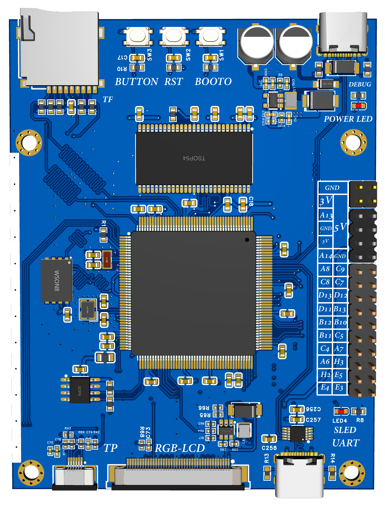
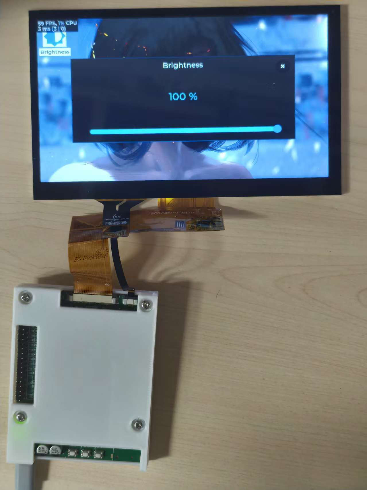

# STM32H7LVGL
基于STM32H743VIT6的RGB-LCD开源开发板，板载32MB SDRAM、SPI Flash与TF卡，含RGB565屏与触摸接口。外设全实测：SDRAM@120MHz零错误，LVGL稳定60
# H743-LCD 开发板
<div align="center">



</div>

---

//bibi链接：https://www.bilibili.com/video/BV1QTHd6hEuJ/?spm_id_from=333.1007.top_right_bar_window_dynamic.content.click
//立创开源：  https://oshwhub.com/sunmingyi1/project_tvfkmdfu
//github开源：https://github.com/sunsun033/STM32H7LVGL

## ✨ 简介

这是一块完全开源的 **STM32H743 高性能开发板**，主攻方向是 **RGB-LCD 图形界面应用**。

设计目标很简单：把跑 GUI 最需要的几样东西——**大内存、大屏接口、高速存储**——在一块小板上全部凑齐，到手即用，不用再飞线。

所有外设均已上实物验证：

| 外设 | 状态 | 实测结果 |
|---|---|---|
| SDRAM（W9825G6KH，32MB） | ✅ 已验证 | **120MHz 主频下 MemTest 0 错误** |
| RGB-LCD + 电容触摸 | ✅ 已验证 | **LVGL 稳定 59~60FPS，CPU 占用 ~1%** |
| SPI Flash（Winbond，WSON8） | ✅ 已验证 | 读写正常 |
| TF 卡 | ✅ 已验证 | 读写正常 |
| Type-C 供电 / 调试串口 | ✅ 已验证 | — |
| 用户按键 ×3（USER / RST / BOOT0） | ✅ 已验证 | — |

> 📹 实机演示视频见仓库 Release / 讨论区（LVGL 演示 + 亮度调节）。

## 🖼️ 实机运行效果

LVGL 演示稳定运行在 **59~60 FPS**（左上角为 LVGL 性能监视器：`59 FPS, 1% CPU`）：

<div align="center">

| | |
|:---:|:---:|
|  |  |

</div>

实物（三层板载结构：主控 + SDRAM + Flash，全部国产料，成本可控）：

<div align="center">


</div>

## 🔧 硬件配置

### 核心参数

| 项目 | 参数 |
|---|---|
| 主控 | **STM32H743VIT6**（LQFP144） |
| 内核 | ARM Cortex-M7 @ **480MHz**，双精度浮点 |
| 存储 | 2MB Flash / 1MB RAM（片内） |
| SDRAM | **W9825G6KH-6**（Winbond，TSOP54，**32MB**），运行于 **120MHz** |
| SPI Flash | Winbond WSON8 封装（W25Qxx 系列） |
| 显示接口 | **RGB565**，40pin FPC，直驱 RGB 接口 LCD |
| 触摸 | 电容触摸（TP 座，I2C） |
| 存储扩展 | TF 卡座 |
| USB | Type-C ×2：DEBUG（供电 + 调试串口）/ UART |
| 按键 | USER / RST / BOOT0 |
| 指示灯 | POWER LED / SLED（串口状态） |
| 扩展 | 2.54mm 双排排针，引出 GPIO + 3.3V / 5V / GND |

### GPIO 扩展口引出（丝印顺序）

```
GND  3V   A13  A14  5V   A12  A11  C9   C8   C0
C6   C7   D13  D12  D11  B11  B10  C3   C2   C4
C5   A7   H3   H4   E6   ...
```

> 完整引脚分配请查阅 `Hardware/` 目录下的原理图。

## 📁 目录结构（规划）

```
├── Hardware/          # 嘉立创EDA工程导出：原理图 PDF、PCB、BOM
├── Firmware/          # 固件源码（Keil / STM32CubeIDE 工程）
│   ├── Drivers/       # BSP：SDRAM、LCD、Touch、Flash、TF
│   ├── Middlewares/   # LVGL 等
│   └── ...
├── images/            # 文档图片
└── README.md
```

## 🚀 快速上手

1. **供电**：Type-C 线接入 `DEBUG` 口（同时提供 5V 电源与 USB 转串口调试）
2. **下载**：板载 `BOOT0` 按键配合 RST 可进入系统 Bootloader 串口下载；也可从 `UART` 口 / SWD 飞线下载
3. **跑演示**：固件内置 LVGL 演示，上电直接运行；TF 卡 / SPI Flash 可存放图片等资源
4. **二次开发**：BSP 驱动齐全（SDRAM / LCD / TP / Flash / TF），直接基于工程添加你的应用

## 📌 已知说明

- SDRAM 时钟为 **120MHz**（W9825G6KH-6 频率裕量充足，长时间 MemTest 稳定 0 错误）
- RGB 屏为 **RGB565** 接口，FPC 40pin；换屏需按屏幕时序修改 LCD 驱动参数
- 触摸芯片型号请看原理图 TP 部分标注（I2C 接口）

## 🗺️ TODO

- [ ] 完整引脚表 / 引脚复用对照表
- [ ] LVGL 移植教程文档
- [ ] TF 卡 + FatFs 例程说明
- [ ] 3D 打印外壳（见实物照片中的白色外壳）

## 🤝 参与贡献

欢迎提 Issue / PR。板子还在迭代，有任何建议（硬件改进、驱动优化、文档纠错）都非常欢迎。

## 📄 开源协议

硬件：**CERN-OHL-S** ｜ 代码：**MIT** ｜ 文档：**CC BY-SA 4.0**

> 待定，可根据你的需求调整。

---

<div align="center">

**如果这个项目对你有帮助，欢迎点个 ⭐ Star**

</div>
